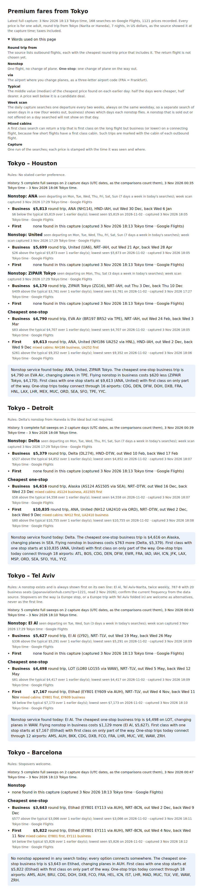

# FIELD REPORT — fares-two — 3 Nov 2026

Times are JST with UTC in brackets. Session fares-two ran on the Linux machine agent-machine-dan over Remote Control, in auto mode (read with get_session: `permission_mode: auto`).

## What stands

- **Pull request** https://github.com/isleofdan/fares/pull/2 "fares-two: grid fitted to what is on sale, history line on the page", from `claude/fares-two` into main. It is open and NOT MERGED. It merges on Dan's typed line in a cloud session; this machine session never merges.
- **The first daily capture worked.** The tmux window `fares` started at boot and ran sweep 7 and week scan 8 with no refusals (numbers under Verify).
- **Grid.** The default horizon is now 294 days (it was 300), measured from the store. `--horizon` runs any other grid by hand, for example `--horizon 300`. Each sweep's capture.log line now ends with the last departure that had results, per route and cabin (commit 3e2cb38).
- **Page.** Each route section has a new line above the nonstop lines, for example "History: 5 complete full sweeps on 2 capture days (UTC dates, as the comparisons count them), 3 Nov 2026 00:35 Tokyo time – 3 Nov 2026 18:06 Tokyo time." The live page was re-rendered from the store and the screenshot was committed (commits 7f18f0c and 82dfa04).
- **Keyed sources.** PLAN.md, "Fare sources tried", now has a table of Amadeus Self-Service, Duffel, Kiwi.com Tequila, SerpApi and Travelpayouts. Every cell comes from the source's own page, with its link, or says "not found". Nothing was wired; no key was made and no account opened (commits 3baa9a9 and 6c8fc29).
- **Close-out note** "fares-two" in PLAN.md, and README "Run it" lines for `--horizon` (commit e7fe6b6). The note's step 2 dates were corrected after result check 1.
- **Team.** Rig `fares-two-mixed` (id `01M6GAAC4EEF2DFZWXN570BC2N`): builder `dev-owner@fares-two-mixed` (Claude Code, auto mode) did steps 3 to 6, and checker `dev-check@fares-two-mixed` (Codex) checked them twice.
  - Builder task row: `qitem-20261103090325-92ed33d02f86c9c2`.
  - Check 1: `qitem-20261103091427-845bf1e0`, returned on `qitem-20261103091615-b39201e8`.
  - Check 2: verdict row `qitem-20261103091756-0b882d210287c046`.
  - The checker's recorded final verdict, verbatim: "PASS candidate 6c8fc29: both requested documentation corrections verified."
- **Team stopped with a snapshot:** `rig down fares-two-mixed --snapshot` gave snapshot `01M6GB81XB0RDCVN69EZ4ZHNKX`. OpenRig printed the restore line `rig up 'fares-two-mixed' --existing`, which is only for continuing this job. Both are recorded in /data/home/dan/FACTS.md, OpenRig section.

Screenshot on GitHub: https://github.com/isleofdan/fares/blob/claude/fares-two/docs/fares-page.png

## Verify

1. **Environment.** The surface test printed `MACHINE`. Permission mode is auto. `tmux list-windows -t main` lists `3: fares`. `/data/home/dan/fares/.venv/.requirements-installed` exists (3 Nov 08:19 UTC). The OpenRig check `rig ps` answered `0 rigs · 0 seats`, with 25 stopped and 58 archived. Disk: `/data` 28 GB free of 50 GB.
2. **Step 1, the first capture** (read only; the sweeps table was read with Python sqlite3 in read-only mode). loop.log: `2026-11-03T08:19:25Z fares daily run`, then one line `h2 connection driver error: connection error detected: detected excessive load generating behavior`, then `wrote /data/home/dan/fares-data/fares.html`.

   | Sweep | Start (UTC) | End (UTC) | Kind | Searches | Refusals | Rows | Complete |
   |---|---|---|---|---|---|---|---|
   | 7 | 08:19:26 (17:19 JST) | 08:27:46 | full sweep, every 14 days | 168 | 0 (failed 0, throttled 0) | 1,133 | yes (8.3 min) |
   | 8 | 08:27:46 | 08:29:11 | week scan | 28 | 0 | 251 | yes (1.4 min) |

   Earlier sweeps, from fares-one on 2 Nov: 1 (incomplete, 145 rows); 2 (every 7 days, 336 searches, 17 refused, 2,293 rows, marked complete); 3 and 6 (week scans); 4 and 5 (every 14 days, 168 searches, 0 refused, 1,140 and 1,152 rows).
3. **Step 2, the sale horizon** (read only, across complete full sweeps 2, 4, 5 and 7 together). Sweeps 2, 4 and 5 started 2 Nov and sweep 7 started 3 Nov. Sweep 2 searched every 7 days and the others every 14. The grid's last departure is 281 days after the sweep day, because a 7-night trip must be back within 300 days. Searches refused in sweep 2 were left out. No route had an empty date inside its answered range.

   | Route | Cabin | Latest departure with results, any complete sweep | Every later search, in every complete sweep, empty from |
   |---|---|---|---|
   | Houston | business, first | 2027-06-22 (sweep 2; 232 days after 2 Nov) | 2027-06-29 (sweep 2; sweeps 4, 5 and 7 empty from 2027-06-29 and 2027-06-30) |
   | Detroit | business, first | 2027-06-22 (sweep 2; 232 days after 2 Nov) | 2027-06-29 (as Houston) |
   | Tel Aviv | business, first | 2027-06-08 (sweep 2; 218 days after 2 Nov) | 2027-06-15 (sweep 2; sweeps 4, 5 and 7 empty from 2027-06-15 and 2027-06-16) |
   | Barcelona | business, first | 2027-08-11 (sweep 7; 281 days after 3 Nov, the last grid date) | never empty inside the grid |

   The 14-day sweeps alone stop earlier (Houston and Detroit 2027-06-15/16, Tel Aviv 2027-06-01/02) only because they do not search the in-between dates. PLAN.md's claim that three routes go blank about 8 months out is confirmed: Houston and Detroit at about 7.6 months, Tel Aviv at about 7.2 months. Barcelona did not go blank inside the grid.
4. **Step 3, the measured horizon.** The latest answered trip departs 281 days out and returns at 288. Rounded up to the next multiple of 14 that is 294, under the 300 cap.
5. **Hand run with the new default** (`bin/capture`, started by the builder seat, not by the loop): sweep 9, 09:04:49–09:13:19 UTC (18:04–18:13 JST). It ran 168 searches with 0 failed and throttled 0, took 8.5 minutes and wrote 1,121 rows, marked complete. Its capture.log line ends `horizon=294d … last=houston/business:2027-06-16 last=houston/first:2027-06-16 last=detroit/business:2027-06-16 last=detroit/first:2027-06-16 last=tel-aviv/business:2027-06-02 last=tel-aviv/first:2027-06-02 last=barcelona/business:2027-08-11 last=barcelona/first:2027-08-11`.
6. **Tests.** `.venv/bin/python -m unittest discover -s tests -t .` gave `Ran 21 tests … OK`, run by the checker and again by this session. fares-one had 16.
7. **Screenshot.** docs/fares-page.png shows all four route sections, Houston, Detroit, Tel Aviv and Barcelona, each with its History line (embedded above; this session viewed it).
8. **Step 5's table** is in PLAN.md, and every row that claims anything carries a link. The checker spot-checked Amadeus, Duffel, SerpApi, Travelpayouts and Kiwi against their pages.
9. **Store after the session:** 7,719 fare rows. No row was updated or deleted.

## Checks

| Round | Id | Verdict | What changed |
|---|---|---|---|
| Brief check 1 | job 20261103-085227-7b5dae | FINDINGS | Brief corrected before this session (card event 2416) |
| Brief check 2 | job 20261103-085447-eec4d2 | PASS | – |
| Team check 1 (dev-check) | qitem-20261103091427-845bf1e0, verdict on qitem-20261103091615-b39201e8 | Two documentation corrections asked; code and page clear | (1) PLAN.md said re-running with `--horizon 300` would show a wider horizon, but at 14-day spacing it plans the same 21 trips. It now says an explicit wider probe is needed (`--every 7 --horizon 300`, with the refusal caveat). (2) Kiwi's wording now matches its source: new Tequila partnerships by invitation only. Both fixed in 6c8fc29. |
| Team check 2 (dev-check) | qitem-20261103091756-0b882d210287c046 | PASS candidate 6c8fc29 | – |
| Result check 1 | job 20261103-092050-7443eb (report event 2419) | FINDINGS | (1) Step 2's table mixed sweep 7's dates with sweep 2's: now the latest departure and blank-from date across all four complete sweeps, with explicit dates (Houston and Detroit 2027-06-22, Tel Aviv 2027-06-08); PLAN.md's close-out note corrected the same way. The horizon (294) is unchanged: it rests on Barcelona, 2027-08-11. (2) This section lacked the result-check tools' details and outcome: added below. |
| Result check 2 | run on this corrected report; its verdict is named in the closing message | – | – |

Result-check tools, as their schemas document them. `check_result` takes card (required), pull_request (required, one GitHub PR URL), and optionally report or report_event, and brief or brief_event. It answers at once with a job id. `result_check_status` takes job. Its state is queued, running, done or failed; verdict is PASS, FINDINGS, or null until done; findings are numbered, each with step, problem, evidence and fix. FINDINGS means fix every finding and check again; failed means the check did not finish and must be run again, never read as a pass. This session called `check_result` with card `fares`, pull_request https://github.com/isleofdan/fares/pull/2, report_event 2419 and brief_event 2416, then read `result_check_status` until state was done.

## Stall watch

Dan asked for a check every 5 to 7 minutes, with any stall recorded for this report and for the room (for D-Dot). From 18:12 JST (09:12 UTC), a check every 6 minutes recorded both seats' queue states, the commit count and whether each screen had moved, and saved each screen. The machine's seat-watch ran the whole time. No real stall happened, so nothing went to the room.
- 18:09 JST (09:09 UTC): a false alarm. OpenRig's own sweep opened recovery row `qitem-recovery-07a9dfe1dd35402c` ("stalled-after-claim") 6 minutes after the builder claimed its row. The builder was waiting on the 8-minute hand capture in a background shell, with 3 commits already made. It noted progress on its row and closed the recovery row as done / no-follow-on. Cost: none.
- 18:12 JST check: builder queue `35402c=done 86c9c2=in-progress`, 3 commits, both screens moving.
- The whole job, from the job being sent (09:03 UTC) to the final PASS (09:18 UTC), took about 15 minutes, with no permission prompt on any seat (0 answered).

## Divergences

- **Rig name.** `rig-up-auto.sh` on `first-project-mixed` failed five times: "already RUNNING: 01M56TG4ZSH7BGDBAK4VQ32PSF", the stale record FACTS.md names. As earlier sessions did, I made the spec copy `~/openrig-setup/rig/fares-two-mixed.rig.yaml` (only `name:` changed) and started it with the same script. The builder came up in auto mode.
- **Second team check.** The checker said its prose corrections needed no second round. I asked for one anyway, so the candidate pushed carries a recorded PASS.
- **Step 2 done by the supervisor, steps 3 to 6 by the team,** as the brief says. The measured table was handed to the builder in the job text.
- **The supervisor made one PLAN.md edit itself** after result check 1: the close-out note's step 2 dates (one sentence). It is not team work, and is named here as such.

## What the brief got wrong

- **The horizon rule saves nothing.** Barcelona answers on the grid's last date, so the measured horizon is set by the grid itself, not by what is on sale. At 14-day spacing, 294 days plans the same 21 departures as 300; only the stated limit changed. The real waste is per route: Houston and Detroit are empty after about 232 days and Tel Aviv after about 218, so 26 of 168 searches a day return nothing (4 departures on each Houston and Detroit cabin, 5 on each Tel Aviv cabin). Fitting that needs a per-route horizon in routes.json, which the brief's single default does not allow. Where Barcelona stops selling is not yet known.
- **"Record the snapshot in FACTS.md as the previous session did."** fares-one recorded no fares rig in FACTS.md (grep for `fares-one` finds nothing). This session added its own line.
- **Sweep 2 counts as complete with 17 refusals.** The store marks it complete, because its refusals never came 3 in a row, so it was not throttled. That matches the rule as written ("not throttled"), but "every planned search ran" reads stricter. I left the rule unchanged; the next brief may want to decide it.

## What the next session needs (for the Spine-pages brief)

- **The page:** /data/home/dan/fares-data/fares.html, 12.4 KB of plain HTML, one section per route (4). The full-page screenshot is 900 × 3938 px.
- **How often it changes:** once a day. The loop runs capture, then week scan, then page, and repeats 24 hours after each run started. The clock is set by the last boot: this one started at 17:19 JST (08:19 UTC), and a deploy or restart moves it. A run takes about 10 minutes. A hand run (`bin/capture`, then `bin/page`) changes it at any time.
- **For a Wall card** (few, slow-moving numbers): per route, today's cheapest business and first price and whether it is below or above typical; the count of complete sweeps and capture days; the last sweep's searches and refusals.
- **For a page:** the per-flight lines (nonstop carriers, one-stop via airports, mixed-cabin marks), the days each nonstop flies, and the history comparisons. These change daily and are long.
- **Grid facts:** 168 searches a day at 14-day spacing, 0 refusals in 4 straight full sweeps. The 7-day grid (336 searches) drew 17 refusals once.

## Fly machine and OpenRig lessons

- **`first-project-mixed` is still blocked** by the stale RUNNING record `01M56TG4ZSH7BGDBAK4VQ32PSF`. It cost five retries, about a minute. A spec copy fixed it. Lasting fix: archive that record through the agent-machine repo's OpenRig notes, or have `rig-up-auto.sh` fall back to a per-job copy by itself.
- **OpenRig's stalled-after-claim sweep fires at 6 minutes.** Any seat running a quiet job of 8 minutes or more (a capture, a build) trips it. The builder cleared it itself, at no cost. A job text that says "a long quiet shell is expected" may avoid it.
- **`rig queue list` returns JSON:** grepping state words also counts nested rows. Parse it with Python and read `.state` and `.qitemId` only.
- **`rig send` from the supervisor prints a "no sender identity" advisory.** It is harmless, because the job text starts with "This is Dan, via session …".
- **A foreground `sleep` is refused** in this harness, so a wait on a check runs in the background or polls the status tool directly.

## Asks

None.

## Closing message to Dan

The first daily capture ran clean on the machine: 168 searches, no refusals, 1,133 prices in 8 minutes. Fares are on sale about 232 days out on Houston and Detroit and 218 on Tel Aviv. Barcelona sells as far as the search reaches, so the measured limit is 294 days and the daily search does the same 21 dates per route as before. Skipping the empty dates for Houston, Detroit and Tel Aviv would need a per-route limit, a later change. The page now shows, on each route, how many days of history its "typical" and "lowest seen" rest on: 5 complete sweeps over 2 days so far. The paid fare sources are written up for later: only Amadeus and Duffel give fare codes, and Kiwi takes new partners by invitation only. Pull request: https://github.com/isleofdan/fares/pull/2 (not merged; it merges on your line in a cloud session). Needed from you: nothing to decide.
